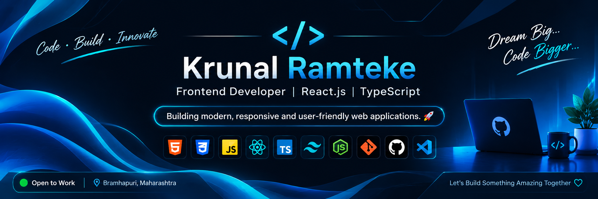

<!-- ================= HEADER BANNER ================= -->

  

 

<!-- ================= INTRODUCTION ================= -->

# Hey there! 👋 I'm Krunal Ramteke

### 💻 Frontend Developer | React.js | TypeScript

Building modern, responsive and user-friendly web applications.

 

---

<!-- ================= ABOUT ME ================= -->

## 🚀 About Me

- 👨‍💻 I'm a Frontend Developer passionate about building web applications.
- ⚛️ Working with React.js, JavaScript and TypeScript.
- 🎨 Creating responsive interfaces using Tailwind CSS.
- 🔥 Building real-world projects to improve my development skills.
- 🌱 Currently learning Backend Development with Node.js.
- 🎯 My goal is to become a Full Stack Developer.

---

<!-- ================= TECH STACK ================= -->

## 🛠️ Tech Stack & Tools

### Frontend Development

### Backend & Database

### Tools & Technologies

---

<!-- ================= PROJECTS ================= -->

## 🚀 Featured Projects

<table>
<tr>
<td width="50%">

### 🏢 PeopleHub

**HRMS Application**

A Human Resource Management System featuring employee management, departments, attendance, leaves and payroll.

**Tech:** React, TypeScript, Tailwind CSS

</td>
<td width="50%">

### 🌦️ WeatherSpace

**Weather Application**

A weather application that detects your location and provides weather information with city search functionality.

**Tech:** React, JavaScript, API, Tailwind CSS

[🔗 View Project](https://github.com/krunal0234/Weather-app)

</td>
</tr>

<tr>
<td width="50%">

### 🛒 Normal Shop App

**E-Commerce Application**

A shopping application built while learning React, featuring product listings and shopping functionality.

**Tech:** React, JavaScript, CSS

[🔗 View Project](https://github.com/krunal0234/normal-shop--app)

</td>
<td width="50%">

### 📚 Router Project

**React Router Practice**

A React project demonstrating client-side routing, navigation and reusable layouts.

**Tech:** React, JavaScript, React Router

[🔗 View Project](https://github.com/krunal0234/router-project-studyNotation)

</td>
</tr>
</table>

---

<!-- ================= GITHUB STATS ================= -->

## 📊 GitHub Statistics

  

---

<!-- ================= CONNECT ================= -->

## 🤝 Connect With Me

---

### 💙 Thanks for visiting my profile!

**Let's Code • Build • Innovate 🚀**

